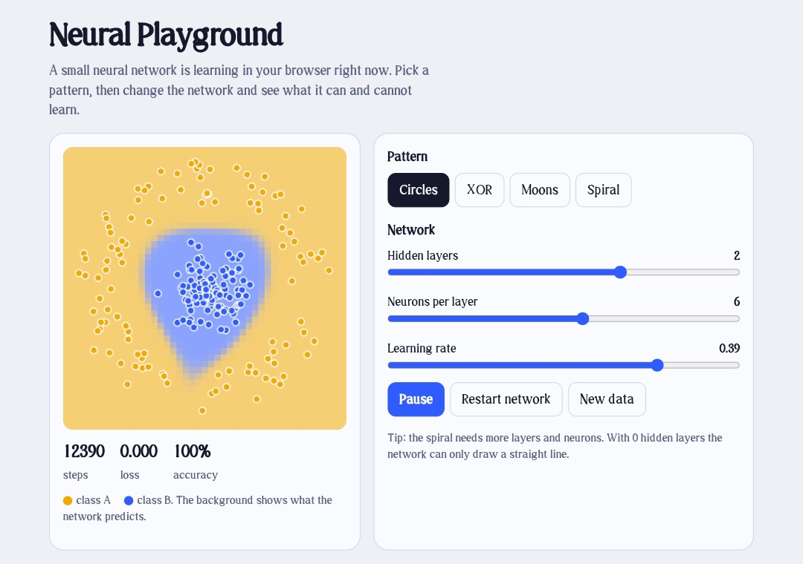

<div align="center">

# 🧠 Neural Playground

**Watch a neural network learn, live in your browser.**

A neural network written from scratch in plain JavaScript. No frameworks, no machine learning libraries, no API calls.

[


](https://vaibhavsingh557.github.io/neural-playground/)
[


](https://github.com/VaibhavSingh557/neural-playground/actions/workflows/ci.yml)


<br>



<sub>The network after 12,390 training steps on the circles pattern: loss 0.000, accuracy 100%.</sub>

</div>

<br>

## Why this project

Most people use machine learning through libraries that hide how it works. This project makes the core idea visible: a model starts out guessing, measures how wrong it is, and nudges its numbers to be less wrong, thousands of times. You can watch that happen in real time.

## Try it

**[Open the live demo](https://vaibhavsingh557.github.io/neural-playground/)**, then:

| Try this | What you will see |
|----------|-------------------|
| Pick **Circles**, set hidden layers to **0** | The network can only draw a straight line, so it fails |
| Add one hidden layer with a few neurons | It solves circles and XOR |
| Pick **Spiral** | It needs more layers and neurons, plus patience |
| Raise the learning rate too high | Learning gets unstable |
| Press **Restart network** | It learns from scratch again |

## Features

- Four patterns: circles, XOR, moons and spiral
- Adjustable hidden layers (0 to 3), neurons (1 to 10) and learning rate
- Live decision boundary with loss and accuracy readouts
- Backpropagation and gradient descent implemented by hand in [`js/network.js`](js/network.js)
- Unit tests that prove the network learns, and prove it fails where theory says it should
- Light and dark mode, keyboard accessible, works on mobile

## How it works

The model is a multilayer perceptron with two inputs (the x and y position of a point) and one output (the probability that the point is class B).

| Part | What it does |
|------|--------------|
| Hidden layers | Each neuron computes a weighted sum of its inputs and applies `tanh` |
| Output | A sigmoid squashes the final value into a probability |
| Loss | Binary cross-entropy measures how far predictions are from the true labels |
| Learning | For each mini-batch of 16 points, backpropagation finds how each weight affects the loss, and gradient descent moves every weight a small step (the learning rate) to lower it |

With no hidden layers the model is just logistic regression, which can only draw a straight line. That is why it fails on circles and XOR, and why adding a hidden layer fixes it.

## Run it locally

Open `index.html` in a browser, or:

```bash
npm start        # serves the app at http://localhost:8000
npm test         # runs the unit tests (Node 18+, nothing to install)
```

## Project structure

```
index.html            page
css/style.css         theme and layout
js/network.js         the neural network: forward pass, backprop, training
js/datasets.js        the four data patterns
js/app.js             controls and drawing
test/network.test.js  unit tests
.github/workflows/    automatic tests and GitHub Pages deploy
```

## Tests

Four automated tests run on every push:

- Training lowers the loss
- A network with hidden layers learns circles and XOR
- A network with no hidden layers cannot learn XOR
- Predictions are always valid probabilities

## Roadmap

- [ ] Momentum and Adam optimizers
- [ ] More activation functions (ReLU, sigmoid)
- [ ] Per-neuron heatmaps
- [ ] An optional LLM explainer that describes what the network is doing

## Author

Built by **[Vaibhav Singh](https://github.com/VaibhavSingh557)**. If you find this useful, a ⭐ on the repo is appreciated.

## License

[MIT](LICENSE)
